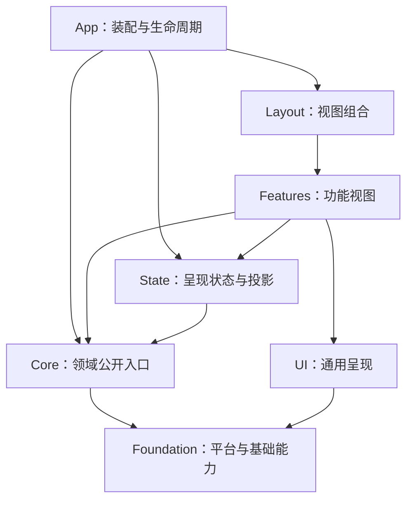

# 0.4.18 架构方案：边界清晰，变化可控

状态：**核心迁移已实现，开发验收中**。适用范围：0.4.18「稳」。本文保留架构决策并更新实际落地位置；迁移前证据见[架构基线](Architecture-Baseline.md)，完成范围与未覆盖项见[开发验收记录](Acceptance-Report.md)。

[版本规划](Development-Plan.md) · [当前架构](../../Architecture/README.md)

## 1. 架构决策

延续 Corona+，在现有分层中补齐领域入口、状态所有权与生命周期。保留 React、Zustand、Tauri、Rust 文本模型和现有扩展运行时；抽象以实际复用与可验证的边界为依据。

每个领域应能回答四个问题：谁能发起操作，谁拥有状态，谁负责释放资源，失败后谁决定下一步。目录调整与这些责任一起迁移。

### A18-01：领域通过小型公开入口协作

`Core/Workspace`、`Core/Documents`、`Core/Git`、`Core/Extensions`、`Core/Configuration` 等领域提供明确的公开 API 与类型。外部模块使用公开入口；领域内部可以直接引用自己的实现。

入口只导出必要契约和能力，运行时代码与纯类型需要可区分。避免把整个目录重新导出为巨型 barrel。一个领域仍可包含多个文件，不要求每个类都建立接口和工厂。

### A18-02：App 管理组合与流程，Core 管理领域规则

内建命令、界面对话框、工作台导航和跨领域装配归 App。Core 通过窄接口请求导航或交互；实现由 App 注入。

例如 Agent 和插件宿主只需表达“打开文件并定位”“请求用户选择”，不需要了解 Zustand Store、React 组件或 Toast。接口应按能力定义，避免注入整个工作台或全局服务容器。

### A18-03：State 管理呈现状态与领域投影

Core 不导入 `State`。领域拥有业务状态和订阅，State 将其投影为界面需要的快照；布局、当前面板、弹层与选择状态仍由对应界面 Store 管理。

Store 的初始化与持久化订阅在 App 装配。恢复、迁移、文件操作和通知流程移出 Store 定义。领域快照与界面投影分别注明来源，派生字段不成为第二个业务写入入口。

### A18-04：操作有返回值，事件表达已经发生的变化

保存文件、打开工作区、切换分支与安装插件通过可等待的用例调用，返回明确结果。通知、计数和可选观察者可以订阅事件。

保留现有 EventBus 的兼容作用，逐步迁移关键操作。为保留事件记录生产者、消费者、载荷与释放责任；异步处理器必须自行处理拒绝或进入明确的异步调用接口。类型归拥有该语义的领域，底层事件工具保持通用。

### A18-05：资源跟随会话释放

应用、工作区、文档、仓库、插件实例分别有生命周期所有者。监听、计时器、watcher、IPC 请求、进程和视图注册绑定到所属会话。

统一最小的 `dispose` 约定与逆序清理工具；异步停止保持可等待。部分启动失败释放已取得资源，延迟注册完成后检查所属会话是否仍有效。关键持久化失败时保留可重试路径，窗口销毁需要确认恢复数据已按现有策略处理；可选服务的停止失败单独记录。

### A18-06：Rust 领域能力独立于 command

工作区状态和授权能力归 `workspace`，文件操作归 `filesystem`，仓库会话与 Git 用例归 `git`。Tauri command 负责反序列化、状态获取、领域调用与兼容错误映射。

保留现有 IPC 名称与序列化格式。内部模块搬迁优先使用短期重导出，调用侧按领域迁移；其他业务模块停止从 `commands` 取得领域状态。

## 2. 目标目录

下列为本轮落地部分，其余成熟模块按现有位置维护。没有为了对齐目录名称移动已能独立验证的 Editor Hooks，设置投影保留在对应 Feature。

```text
Src/
  App/
    AppServices.ts            服务启停与关闭协调
    Bootstrap/                文档语言适配、配置到主题的应用
    Contributions/            内建命令、面板与功能装配
    Workbench/                标签操作、恢复、导航与交互协调
  Core/
    Commands/                 注册契约、执行结果与上下文
    Workspace/                工作区描述、会话、打开与关闭
    Documents/                文档记录、操作、revision 与订阅
    Editor/                   编辑器能力适配与视图状态契约
    Git/                      仓库会话、查询、写操作与缓存
    Extensions/
      Host/                   宿主能力与桥接契约
      Marketplace/            目录、下载、安装与运行时用例
    Configuration/            有效配置、默认值、更新契约
    Debug/                    调试契约与运行状态
  State/
    Workbench/                标签与布局状态、选择器
    useDebugStore.ts           调试领域的 React 绑定
    useExtensionStore.ts       扩展 Registry 的 React 绑定
  Features/
    Editor/
      Hooks/                  保留输入、提交、选区与视口协调
      components/             保留文本、装饰和预览组件
    SourceControl/            Git 视图、交互状态与展示组件
    Extensions/               扩展页面及宿主视图呈现
    Settings/                 设置页面、字段与偏好投影 hooks
  Foundation/
    Desktop/                  平台适配
    IPC/                      类型化宿主协议
    Storage/                  原子读写与持久化适配
    Lifecycle/                最小资源释放工具
  Layout/                     工作台区域与视图插槽
  UI/                         通用组件、材质、图标、提示

src-tauri/src/
  workspace/
    mod.rs                    状态、代次与路径授权
    digest.rs                 有界目录摘要
    ipc.rs                    工作区和文件命令薄适配
    filesystem/               读写、目录、watcher、恢复及测试
  git/
    mod.rs                    会话、执行与查询
    recovery.rs               丢弃备份、恢复日志与恢复流程
    ipc.rs                    保留原协议的命令适配
    tests.rs                  临时仓库与故障回归
  editor/                     mod.rs 文本模型、ipc.rs、tests.rs
  extensions/
    runtime/
      mod.rs                  契约、上下文、组件引擎与桥接
      resources.rs            租约、事件、watcher 与清理
      limits.rs               现有资源额度
      host.rs                 文件、进程、网络、存储与视图能力
      tests.rs                真实组件、权限与资源测试
  commands/                   迁移领域重导出；其余历史命令保留
```

命令注册器已迁至 `Core/Commands/CommandRegistry.ts`，内建命令装配进入 `App/Contributions`。SDK 契约位于 `Core/Extensions/Host/HostContracts.ts`，SDK 实现通过宿主公开入口导出；输入框、Quick Pick 和工作台端口由 `App/Contributions/ExtensionSDK.ts` 装配。

现有 Editor Hooks 和坐标模型继续复用。本轮改动文档事务边界和语言适配，不替换输入、渲染内核或为目录整齐再造一层控制器。

## 3. 依赖规则



图展示主要允许关系；App 可组合所需视图和适配器，Layout 可使用通用 UI。依赖检查还需约束以下细节：

| 边界 | 0.4.18 目标 |
| --- | --- |
| Core → State、Features、Layout、App、UI | 运行时与类型引用均禁止；交互通过领域契约与 App 适配 |
| Foundation → 业务层 | 保持禁止；通用工具不持有业务事件或业务 Store |
| UI → 业务状态或服务 | 保持禁止；业务信息通过参数传入 |
| 跨领域引用 | 使用领域公开入口，禁止穿透私有实现 |
| 跨 Feature 引用 | 视图组合移至 App/Layout，公共能力提到所属领域或通用 UI |
| 页面 → 底层 IPC | 本版迁移范围内使用领域用例；存量适配引用逐项登记，不扩散 |
| 领域 → Tauri command 模块 | workspace/Git/editor/runtime 使用迁移后的领域能力；LSP/DAP 的旧停止入口保留并在当前架构说明中登记 |

检查器使用 TypeScript 配置解析模块，覆盖重导出、别名和类型引用，避免重命名目录后规则失效。新增规则先输出存量清单；本版目标范围必须清零，其余例外写明原因、所有者与退出条件，禁止用宽泛目录豁免吞掉新增违规。

## 4. 状态所有权

| 状态 | 唯一业务来源 | 界面侧保留内容 | 持久化与恢复 |
| --- | --- | --- | --- |
| 已生效工作区、路径授权、代次 | Rust 工作区会话；前端服务维护对应描述 | 候选路径、授权交互、切换进度 | 最近目录通过存储适配恢复，授权成功后提交 |
| 文本内容、revision、磁盘指纹 | Rust 文本模型 | 文档快照、尚未确认的输入事务、错误状态 | 保存与恢复沿用现有确认及冲突语义 |
| 光标、选区、视口与折叠 | 当前编辑器视图控制器 | 按文档隔离的视图状态 | 使用现有视图记忆策略 |
| 标签、活动面板与布局 | 工作台呈现 Store，由工作台协调器更新 | 当前排列与选择 | 布局持久化独立；文档 dirty 从文档快照派生 |
| Git 状态、共享请求与仓库上下文 | Git 领域服务与后端仓库会话 | 筛选、输入、展开和操作反馈 | 缓存绑定仓库身份与会话，界面不自行维护另一份业务缓存 |
| 插件包、权限与运行实例 | 后端扩展服务 | 描述符、视图快照与页面交互状态 | 权限文件、包与启动快照分别保留原有用途 |
| 用户有效配置 | 配置服务解析默认值与已保存用户值 | 未提交草稿、保存进度、应用结果 | 复用 UserConfigStore，快照标记来源与有效期 |
| 调试会话与变量 | Debug 领域服务 | 展开、筛选与选中状态 | 保留当前会话与重启语义 |

前端可以有响应迅速的乐观状态，但必须标注未确认事务，并在后端失败时恢复或显示可重试状态。持久文档、授权和仓库操作不由页面乐观状态替代确认。

## 5. 六条关键链路

### 工作区：候选、授权、提交、释放

打开与恢复进入同一协调流程。授权监听就绪、主界面可见、工作区已提交分别表示不同状态。每次切换有可识别的操作上下文；旧操作完成前检查是否仍可提交。

关闭、拒绝、暂缓与路径失效返回不同结果。授权请求、watcher、Git/LSP/终端等消费者由各自所有者释放；工作区协调器管理切换顺序。延续 0.4.17 的自研 Toast 与弹窗，不让授权阻塞 splash 挂载。

### 文档与编辑器：编辑事务、领域快照、视图坐标

文档服务管理打开、编辑、保存与关闭；LSP 同步通过明确的订阅适配器连接。语言服务不可用时保留基础编辑能力，语言错误进入对应输出通道。

编辑器协调层管理输入、IME、撤销、选区与视口的交互；渲染层使用同一坐标与字体测量结果。继续复用现有 EditorLayoutMetrics、UTF-16 和 CRLF 处理，任何坐标抽象调整先验证光标、命中测试、选区和装饰层。

### Git：共享查询与写操作分开

SourceControl、状态栏和 gutter 使用同一 Git 领域入口。查询可以合并请求；消费者解绑只释放自己的消费关系，工作区切换和显式取消由会话所有者处理。

写操作沿用后端仓库锁与授权检查，并在完成后统一刷新相关读模型。错误区分正常取消、上下文过期和实际失败。Git 进程继续使用现有进程服务，避免新增平行执行体系。

### 插件：安装、激活、桥接、呈现分开

Marketplace 按目录请求与缓存、账户交互、扩展安装、语言工具与共享运行时安装拆分。安装过程保留验证、临时文件清理、失败回滚与卸载语义。

宿主能力按文档、工作区、命令、输出、状态栏与交互定义接口，由 App 装配。插件实例结束时集中回收桥接请求、事件、watcher、命令、状态栏、视图与运行租约。停用期间的新请求得到明确结束结果。

### 设置：有效值、保存、生效

默认值与解析规则集中维护。字段编辑、恢复默认、启动恢复和插件配置写入走相同的配置更新契约；持久化结果与运行时生效状态分别可见。

安全选项保持可配置，范围覆盖扩展包签名、目录签名、工作区、本地进程、安装、扩展执行、AI 端点、删除与 Git 丢弃审批。关闭后重启仍保留选择；更新签名继续遵守现有独立策略。

### 主题与反馈：共享语义与呈现适配

启动与设置页使用同一配置应用入口。编辑器、通用控件、终端与插件 Webview 从主题快照取得颜色、字体和材质语义；彩色资源保留原色，单色资源使用主题色。

业务层返回错误或操作结果，App/Features 决定 Toast、对话框与输出通道。共享按钮、菜单、胶囊和玻璃材质继续复用现有设计规范，重点修复样式来源分散与重复背景。

## 6. 兼容与迁移约定

| 接触面 | 本版约定 |
| --- | --- |
| IPC 命令与 JSON 字段 | 保持现有契约；模块重排不顺带重命名协议 |
| 用户配置、布局、权限与恢复数据 | 保持可读取；必要迁移独立、可测试，保留原数据失败恢复路径 |
| 文档 revision 与保存 | 继续由 Rust 确认；避免 UI 状态反向覆盖已确认文本 |
| 扩展 WIT、AURX 与 VSIX | 保持已支持接口与打包约定；内部拆分补充真实组件与 Demo 回归 |
| 命令、视图和扩展 ID | 保持稳定；旧内部路径适配与对外 ID 分开处理 |
| 旧公开服务路径 | 按领域提供短期转发，迁移完调用侧后删除，禁止新代码使用 |

机械搬迁与行为修复分别组织提交，重命名可以审查、回退。同步更新测试、资源打包、审计证据定位和文档路径；不能仅为保住旧路径建立长期空壳。

## 7. 抽象的完成标准

一个抽象完成后，应有明确的调用者、状态所有者、失败结果和资源释放方；能在不启动整套工作台的情况下验证自身行为。只有一个简单调用者的薄封装可以直接保留，无需为统一外观增加多层转发。

本版通过领域接口、会话和少量适配器完成重构。依赖注入框架、全局万能 Manager、统一万物的事件协议、编辑器内核替换与全仓一次性搬迁不属于本方案。
